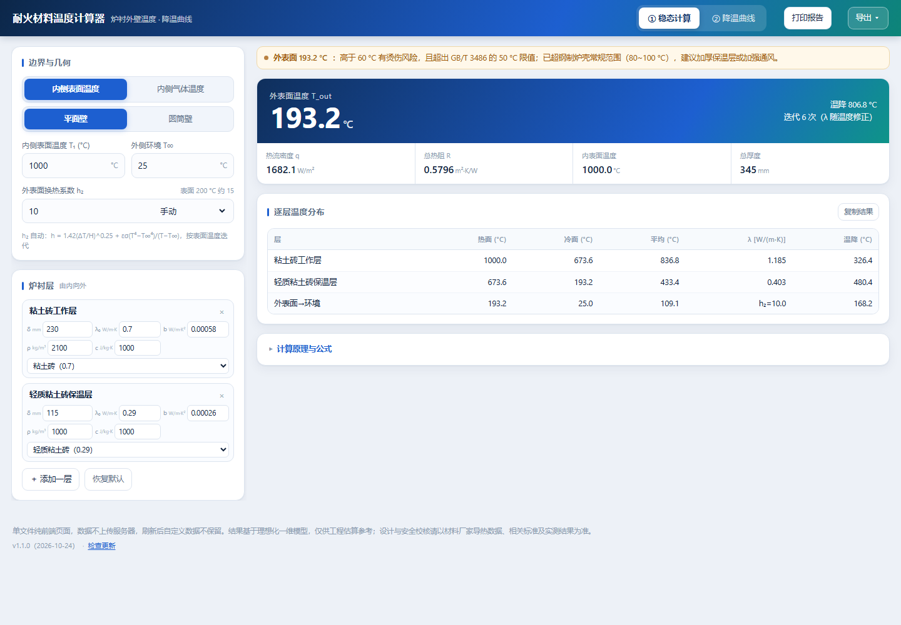
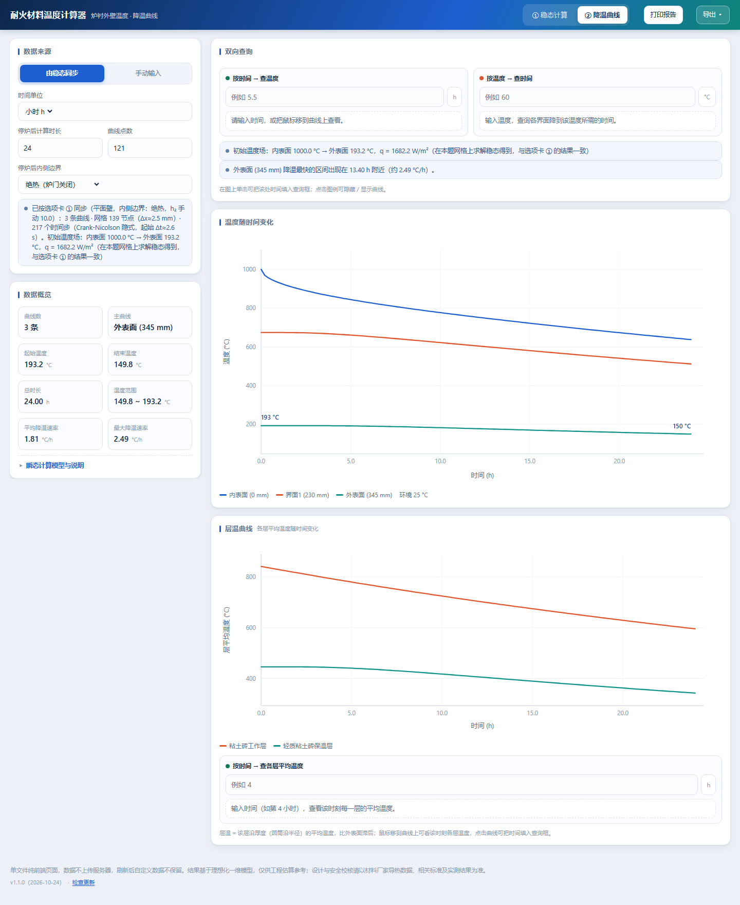

# 耐火材料温度计算器

**一维稳态 / 瞬态导热计算工具 · 单文件网页应用**

[**▶ 在线使用**](https://yangxiaoran2014.github.io/-HTML/) &nbsp;·&nbsp; 版本 **1.1.0**（2026-10-24） &nbsp;·&nbsp; 无需安装、无需联网即可计算（自动更新功能需联网）





---

## 这个工具能做什么

给工业炉 / 窑炉的**耐火材料炉衬**算两件事：

1. **稳态**：已知内表面温度（或炉内气体温度）、各层厚度与导热系数、外部环境，求**外表面（炉壳）温度**、热流密度、逐层温度分布。
2. **瞬态**：停炉后，各层界面温度**随时间**如何下降（降温曲线），可查询任意时刻的温度 / 降到某温度所需时间。

外加一份**黑白 A4 报告**：可打印，也可一键导出成 **Word（.docx）/ PDF** 文件，用于方案比较或技术交底。

典型用途：校核炉壳温度是否超限、比较不同保温层方案、估算停炉冷却时间、判断烫伤风险。

---

## 快速开始

| 方式 | 操作 |
|---|---|
| **在线使用**（推荐） | 打开 <https://yangxiaoran2014.github.io/-HTML/>，直接算 |
| **本地使用** | 下载 `index.html` 双击打开即可（单文件，无任何依赖） |
| **部署到自己的 Pages** | 见下方 [部署](#部署到自己的-github-pages) |

> 所有计算都在浏览器本地完成，**不上传任何数据**；刷新页面会清空当前输入（可用「复制结果」留存）。

---

## 功能详解

### ① 稳态计算（选项卡一）

| 项目 | 支持情况 |
|---|---|
| 几何形式 | **平面壁** / **圆筒壁**（输入内径，外径 = 内径 + 2×总衬厚） |
| 内侧边界 | 已知内表面温度 / 已知炉内气体温度 + 内表面换热系数 h₁ |
| 炉衬层数 | 任意多层，可增删、可调顺序；每层输入 δ、λ₀、b、ρ、c |
| 导热系数 | λ(t) = λ₀ + b·t，按该层两端平均温度迭代求解（线性 λ 时等于严格积分平均） |
| 外表面换热系数 h₂ | **手动**输入，或**自动**按「自然对流 + 辐射」随表面温度迭代计算 |
| 材料预设 | 11 种常用耐火材料，选中自动填 λ₀ / b / ρ / c |
| 输出 | 外表面温度、热流密度（圆筒为线热流 W/m）、总热阻、内表面温度、逐层热面/冷面/平均温度/实际 λ/温降 |

**自动 h₂** 公式（可自设发射率 ε 与特征高度 H）：

```
h₂ = 1.42·(ΔT/H)^0.25  +  ε·σ·(Ts⁴ − T∞⁴)/(Ts − T∞)      σ = 5.67×10⁻⁸
```

> 固定取 h₂ = 10 只适用于外表面 100 °C 左右。表面 200 °C 时真实综合系数约 15，400 °C 时约 29 —— 用自动模式可把外表面温度算准约 20%。

### ② 降温曲线（选项卡二）

| 项目 | 支持情况 |
|---|---|
| 数据来源 | ① **由稳态计算同步**（用稳态温度场作初始条件，自动做瞬态导热）<br>② **手动输入**（粘贴实测时间-温度数据，或按指数冷却模型 T(t)=T∞+(T₀−T∞)e^(−t/τ) 生成） |
| 停炉后内侧边界 | 绝热（炉门关闭）/ 恒温（维持内侧温度）/ 与内侧气体换热（h₁、气体温度） |
| 显示 | 内表面、各层界面、外表面的温度-时间曲线（多条曲线，不同线型） |
| 交互 | 鼠标悬停显示该时刻**所有界面**的温度；图上单击把时间填入查询框；点击图例隐藏/显示某条曲线 |
| 双向查询 | 输入时间 → 查各界面温度；输入温度 → 查各界面降到该温度的时间（非单调时列出全部解） |
| 输出 | 曲线图 + 曲线数、起始/结束温度、总时长、温度范围、平均/最大降温速率 |
| 层温曲线 | 另有一张**各层平均温度**曲线（见下） |

**左侧参数改动，右侧曲线立即重算**（两选项卡共用同一套炉衬参数）。

> 直接分享 `index.html?tab=2`（或 `#curve`）可打开页面即停在降温曲线页。

### ③ 层温曲线（选项卡二）

在「各界面温度」图下方新增一张 **层温曲线**：把每一层沿厚度方向的温度取平均（`T̄ = (1/δ)∫T dx`），得到**每层一条**平均温度—时间曲线。

| 项目 | 支持情况 |
|---|---|
| 曲线 | 每层一条，颜色 + 图例区分；点击图例可隐藏/显示 |
| 悬停 | 显示该时刻**每一层**的平均温度 |
| 按时间查询 | 输入「第几小时」→ 列出该时刻各层平均温度，并给出**层间温差**与最热/最冷层 |
| 点击 | 点图上任意位置，把该处时间填入查询框 |
| 用途 | 看保温层内部的「滞后」降温、判断某时刻各层是否已降到安全温度、估算检修/开孔时间 |

> 界面温度是**某个面**的温度，层温是**整层的平均**温度——后者更接近该层材料的整体热状态（判断材料是否在安全温度区间时更合适）。

### ④ 报告：打印 / 导出 Word / 导出 PDF

顶栏「**打印报告**」（或 <kbd>Ctrl</kbd>+<kbd>P</kbd>）生成**黑白 A4 正式报告**；顶栏「**导出 ▾**」把**同一份报告**直接存成文件。

报告共 5 章，三种输出**内容完全一致**：

1. 计算条件（几何、边界、h₂ 取值方式与分解）
2. 炉衬材料与热物性参数表
3. 稳态温度分布结果（四格结果 + 逐层表 + 结论）
4. 停炉降温曲线（图 1 各界面温度、图 2 各层平均温度，灰阶折线 + 线型区分 + 关键数据）
5. 计算依据、假设与说明 + 生成时间与版本号

| 输出 | 做法 | 适合 |
|---|---|---|
| **打印** | 交给浏览器打印 | 可另存为**矢量** PDF，文字可选中、可检索 |
| **导出 Word（.docx）** | 前端直接写 OOXML，再用极简 ZIP 打包 | 需要**继续编辑 / 加批注 / 改页眉**的场合；标题、加粗、表格边框、曲线图（PNG）齐全，A4 版式（页边距 15/15/14/12 mm） |
| **导出 PDF（.pdf）** | 按 A4 版心逐块渲染为 300 dpi 位图后封装 PDF | **一键下载、无需打印机**；不依赖字体，换电脑、转微信都不会乱码 |

实现要点：三者共用 `#printReport` 这**一份 DOM 和同一套 CSS**——打印走 `@media print`，导出时把同一容器离屏渲染并按打印版心（180 × 271 mm）分页。所以改打印样式，导出结果自动跟着变，不存在两套模板对不上的问题。Word 由 DOM 结构映射为标题/段落/表格/图片；PDF 为图片型（约 1.2 MB / 2 页）。

已处理：页边距归零以**抑制浏览器的网址/页码页脚**、表格分页保护、宋体正文 + 黑体标题、`break-before` 章节分页、末页孤行压缩。

> 要"可选中文字"的 PDF → 用「打印 / 另存为 PDF」；要后续编辑 → 导 Word；只想快速发一份 → 导 PDF。

---

## 计算模型与公式

### 稳态（平面壁）

```
热阻：      Rᵢ = δᵢ / λᵢ                       [m²·K/W]
总热阻：    R = 1/h₁ + Σ Rᵢ + 1/h₂
热流密度：  q = (T_热侧 − T∞) / R                [W/m²]
逐层降温：  T_{i+1} = Tᵢ − q · Rᵢ
外表面：    T_out = T∞ + q / h₂
```

### 稳态（圆筒壁，按每米长度）

```
每层热阻：  R_L,i = ln(r_{i+1}/rᵢ) / (2π·λᵢ)
对流热阻：  R₁ = 1/(2π·r₁·h₁)，R₂ = 1/(2π·r_N·h₂)
线热流：    q_L = (T_热侧 − T∞) / (R₁ + ΣR_L,i + R₂)     [W/m]
表面热流：  q″ = q_L / (2π·r_N)                          [W/m²]
```

### 瞬态（降温曲线）

```
平面壁：ρc ∂T/∂t = ∂/∂x ( λ(T) ∂T/∂x )
圆筒壁：ρc ∂T/∂t = (1/r) ∂/∂r ( r·λ(T) ∂T/∂r )

离散：有限体积 + Crank–Nicolson 隐式格式（Thomas 追赶法求解三对角方程）
     (Tⁿ⁺¹ − Tⁿ)/Δt = ½[ L(Tⁿ⁺¹) + L(Tⁿ) ]
界面导热系数：该面所跨材料的串联（调和）等效值
时间步长：几何递增，起始按表面节点特征时间，每步 ×1.06
```

- **Crank–Nicolson 无条件稳定**，长时限计算不需要放粗网格
- 初始温度场在**同一套网格上重新求稳态**，避免 t=0 出现启动伪瞬变
- 网格约 2.5 mm（薄层自动加密，保证每层至少 2 个节点）

层平均温度（层温曲线）在层内节点间作线性插值后沿厚度积分取平均：

```
T̄_k = (1/δ_k) ∫T(x) dx   （δ_k 为第 k 层厚度；圆筒按 (r−r₁) 的厚度权重）
```

### λ 的温度处理

`λ(t) = λ₀ + b·t`，取该层**两端温度的算术平均**：

- 对线性 λ(t)，这恰等于严格积分平均 `λ̄ = λ₀ + b(t₁+t₂)/2`（精确）
- 程序用迭代法：先假设各层温度 → 求温度场 → 更新 λ → 重复至收敛（通常 3~6 次）

---

## 材料参考值（内置预设）

| 材料 | λ₀ W/(m·K) | b W/(m·K²) | ρ kg/m³ | c J/(kg·K) |
|---|---|---|---|---|
| 粘土砖 | 0.70 | 0.00058 | 2100 | 1000 |
| 高铝砖 | 1.16 | 0.00058 | 2400 | 1000 |
| 硅砖 | 0.93 | 0.00070 | 1900 | 1000 |
| 镁砖 | 5.00 | −0.00270 | 2800 | 1050 |
| 刚玉砖 | 2.30 | −0.00040 | 3000 | 1000 |
| 轻质粘土砖 | 0.29 | 0.00026 | 1000 | 1000 |
| 轻质高铝砖 | 0.47 | 0.00026 | 1200 | 1000 |
| 耐火浇注料 | 0.90 | 0.00050 | 2200 | 1000 |
| 硅酸铝纤维毯 | 0.045 | 0.00020 | 128 | 1000 |
| 保温板/硅钙板 | 0.065 | 0.00012 | 220 | 900 |
| 耐火纤维浇注料 | 0.12 | 0.00020 | 600 | 1000 |

> 以上为**典型参考值**，实际请以材料厂家导热数据或实测为准，可直接改表覆盖。

---

## 结果判据

- 外表面 **> 60 °C**：烫伤风险提示
- **GB/T 3486**：环境 25 °C 时，工业锅炉外壁表面平均温度 **≤ 50 °C**
- 钢制炉壳常规控制 **80~100 °C** 以内（超出会加速氧化、变形）

> 注意：h₂ 是**综合换热系数**（对流 + 辐射）。高温时辐射占主导（表面 200 °C 时约 2/3），建议用「自动」模式或按表面温度查表取值。

---

## 自动更新

页面底部显示当前版本，右侧有「检查更新」；有新版时右下角提示条：

- **在线用户**：「刷新到最新版」（带缓存参数，绕过 Pages 的 10 分钟缓存）
- **本地副本**：「打开线上新版」
- 「稍后」：30 分钟内不再自动提示（仅本次会话）
- 「忽略此版本」：永久跳过该版本（记在浏览器本地）

**检查时机**：打开页面 2.5 秒后、页面可见时每 5 分钟、切回页面（距上次 > 60 秒）、网络恢复、手动点击。
检查带 **15 秒超时**与**并发抑制**，离线时静默失败不打扰。

清单格式（`version.js`）：

```js
window.__APP_UPDATE__ = {
  version: "1.0.3",          // 三段数字，比页面大才提示
  build:   "2026-10-19",
  url:     "https://yangxiaoran2014.github.io/-HTML/",  // 本地副本的「打开线上新版」地址
  notes:   "更新说明，显示在提示条上"
};
```

页面在**托管状态**下读相对路径 `version.js`；**本地打开**时读 `index.html` 里写死的绝对地址 `MANIFEST`。

---

## 发版流程

1. 修改 `index.html` 末尾的 `VERSION` 与 `BUILD`；
2. 修改 `version.js` 的 `version` / `build` / `notes`；
3. **两个文件一起提交**（只改 `version.js` 会让所有旧版用户反复收到无法完成的更新提示）；
4. 等 GitHub Pages 发布与 CDN 缓存刷新（约 10 分钟），必要时 <kbd>Ctrl</kbd>+<kbd>F5</kbd>。

---

## 验证记录

计算内核做过独立校核（不是"跑通即可"）：

| 验证项 | 结果 |
|---|---|
| 三层平壁解析解（b=0） | q = 1200 W/m²、T_out = 120 °C —— 与手算完全一致 |
| 气体模式解析解 | q = 2565.8、T_out = 281.58、内表面 871.71 °C —— 一致 |
| **教材算例**（窑墙 345 mm 粘土砖，Tg=1400 °C，α₁=82，α₂=23） | q = 3989.8（教材 3987.5）、t₁ = 1351.3（1351）、t₂ = 198.5（198） |
| 圆筒稳态 vs 独立径向积分 | 外表面 177.3 vs 177.28 °C |
| 瞬态 vs 细网格 Crank–Nicolson 参考解（能量守恒偏差 0.0000%） | 1 h / 6 h / 24 h 偏差 **≤ 0.03 °C** |
| 长时衰减率 vs 解析特征值 μ₁²α/L² | 偏差 0.015%（Bi=2.3）、0.032%（Bi=6.9） |
| 内侧气体换热边界长期极限 | 与解析稳态偏差 0.001 °C |
| 极端参数鲁棒性（大 b、h₂ 极大/极小、等温、负温、薄层、超厚） | 全部正常，无 JS 异常 |
| 界面回归 | 33 项 UI/功能检查（1440/1280/500 px 三档）全部通过 |
| 打印 | 实际生成 A4 PDF；确认无浏览器页眉页脚、表格不溢出、图为纯灰阶 |
| **层平均温度**（b=0 时稳态剖面为直线，层均温应等于两端平均） | 2 层算例：805.90 / 377.50 °C vs 理论 805.87 / 377.46 °C，偏差 **0.045 °C** |
| 层温物理合理性 | 0/1/2/4/8/12/24 h 各层平均温度逐时单调下降，内层始终高于外层 |
| 层温交互 | 悬停显示各层温度（2 层时 2 个点）、图例隐藏/恢复、按时间查表（含层间温差）均正常 |
| 含图 2 的导出 | Word 3 页 / 2 张内嵌图（180×90、180×70 mm）；PDF 3 页；浏览器打印同为 3 页 |
| **导出 Word** | Microsoft Word 直接打开**无"修复"提示**；页数、表格数（5）、内嵌图（1，180×90 mm）与打印一致 |
| **导出 PDF** | 生成 A4 两页图片型 PDF（300 dpi，2126×3201/页）；逐页像素测量确认表格右边界落在 195 mm 版心内、无裁切 |
| **打印 vs 导出一致性** | 抽取文本逐字比对：**97.4% 完全一致**，差异仅为生成时间戳和"PDF 中曲线文字为位图" |
| 导出鲁棒性 | 非法输入返回提示不抛异常；6 层炉衬仍为 A4 两页；切到选项卡①未绘曲线时也可导出 |

---

## 已知限制

- 一维模型：忽略炉门、看火孔、锚固件等**二维/三维热桥**
- 忽略**层间接触热阻**、内表面**结焦/挂渣层**、材料**相变/析晶**引起的性能变化
- λ 取层平均温度值：对强非线性材料是近似
- 圆筒壁按单位长度计算，未计端部与开孔散热
- 自动 h₂ 的自然对流项采用竖壁层流经验式，强通风/大空间场景建议手动输入
- 停炉降温假定**停炉瞬间为稳态温度场**
- 结果用于工程估算与方案比较；**设计与安全校核**请以厂家数据、相关标准及实测为准
- 导出 PDF 为**图片型**（文字不可选中/检索）；需要可选文字的 PDF 请用「打印 → 另存为 PDF」
- 导出 Word 的分页由 Word 自身排版决定，可能与 PDF 相差一页；文件约 240 KB（含 2 张曲线图）
- 层平均温度按**厚度**加权（圆筒未按面积 r·dr 加权），与「平均温度」的工程习惯一致
- 层温曲线只在「由稳态计算同步」模式下有数据；手动输入模式没有分层信息

---

## 浏览器支持

Chrome / Edge 90+、Firefox 90+、Safari 15+（用到 CSS Grid、`URL`、`closest`、`localStorage`；导出还用到 `XMLSerializer`、Canvas 与 `TextEncoder`，上述浏览器均支持）。
不支持 IE。移动端单列布局可用，建议横屏或平板操作。

---

## 目录结构

```
.
├── index.html      主程序（单文件，含全部样式与脚本）
├── version.js      版本清单（自动更新用）
├── screenshot.png  界面截图
├── README.md       本文件
└── .nojekyll       让 GitHub Pages 跳过 Jekyll 处理
```

---

## 部署到自己的 GitHub Pages

1. 新建**公开**仓库（私有仓库开 Pages 需付费），例如 `-HTML`；
2. 把 `index.html`、`version.js`、`.nojekyll`、`README.md`、`screenshot.png` 上传到**仓库根目录**并提交；
3. 仓库 **Settings → Pages** → Source 选 **Deploy from a branch** → 分支 **main**、目录 **/ (root)** → Save；
4. 等待构建完成，访问 `https://<用户名>.github.io/<仓库名>/`；
5. 如需本地分发的副本也能检查更新，把 `index.html` 里的 `MANIFEST` 改成该仓库 `version.js` 的绝对地址。

---

## 变更记录

| 版本 | 日期 | 内容 |
|---|---|---|
| **1.1.0** | 2026-10-24 | 新增**层温曲线**：每层一条平均温度—时间曲线、悬停看该时刻各层温度、输入小时查表并给出层间温差；报告新增「图 2 各层平均温度」；公式块在分页时不再被截断；支持 `?tab=2` 直接打开降温曲线页 |
| **1.0.4** | 2026-10-23 | 新增顶栏「**导出 ▾**」：一键导出与打印**完全同源**的 **Word（.docx）** 与 **PDF**；报告样式退出 `@media print` 供打印/导出共用；Word 版 A4 版式、表格边框与列宽、曲线图 PNG 嵌入、章节分页与行距优化；PDF 版 300 dpi 图片型两页 |
| **1.0.3** | 2026-10-19 | 「稍后」改为 30 分钟内不再自动提示；版本号与清单同步 |
| **1.0.2** | 2026-10-19 | 自动更新完善：定期检查、切回页面检查、网络恢复检查；刷新带缓存参数；并发抑制与 15 s 超时 |
| 1.0.0 | 2026-10-18 | 首个版本：稳态（平面/圆筒、λ(t)、自动 h₂）+ 瞬态降温曲线 + 黑白 A4 打印报告 |

---

## 免责声明

本项目为工程估算工具，计算结果基于理想化一维模型，**不构成设计文件**。
用于实际工程时，请以材料厂家导热数据、相关国家标准与实测结果为准，并由专业人员复核。

计算全部在浏览器本地完成，页面不上传、不收集任何数据。
